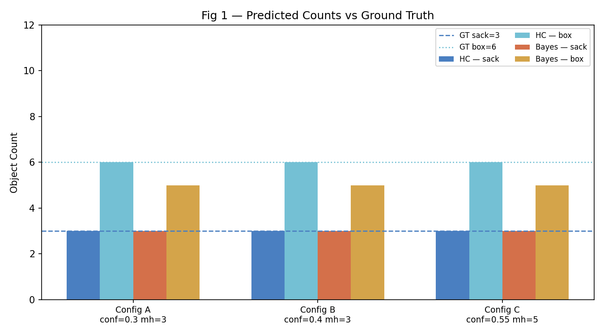
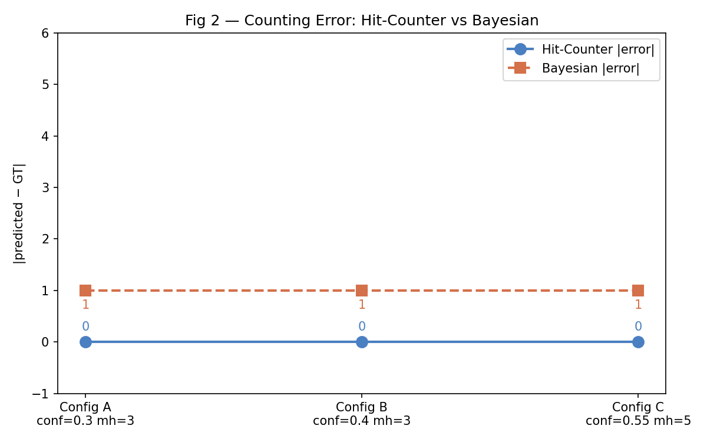
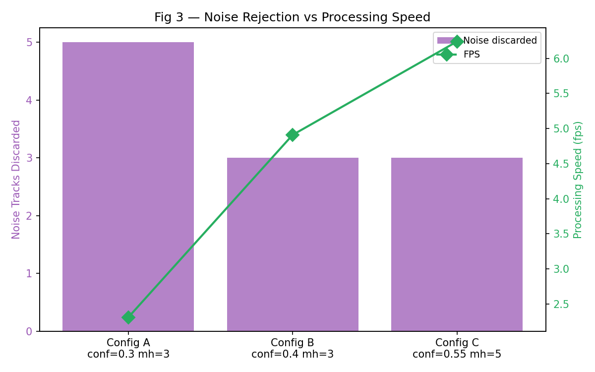

# AL-2002 Artificial Intelligence Laboratory — Project Report
**FAST National University of Computer and Emerging Sciences, Karachi Campus**  
**Department of Software Engineering · Fall 2026**

---

| Field | Detail |
|---|---|
| **Project Title** | Sack and Box Detection and Counting System |
| **Course** | AL-2002 Artificial Intelligence (Laboratory) |
| **Group Members** | Muhammad Ali (24K-3103) · Muhammad Hassan (24K-3051) . Asad Chotani (24K-3072) |
| **Repository** | https://github.com/mhassan25-ops/Object-Detection-AI |

---

## Table of Contents

1. [Project Motivation](#1-project-motivation)
2. [Problem Formulation — PEAS](#2-problem-formulation--peas)
3. [Objectives](#3-objectives)
4. [Dataset and Video Source](#4-dataset-and-video-source)
5. [System Architecture and OOP Design](#5-system-architecture-and-oop-design)
6. [AI Techniques](#6-ai-techniques)
7. [Evaluation Metrics](#7-evaluation-metrics)
8. [Experiments and Results](#8-experiments-and-results)
9. [Discussion](#9-discussion)
10. [Limitations and Ethical Considerations](#10-limitations-and-ethical-considerations)
11. [Member Contributions](#11-member-contributions)

---

## 1. Project Motivation

Warehouses and loading docks require accurate counts of physical goods — sacks and boxes — as they move through the facility. Manual counting is slow, error-prone, and impractical at scale. An automated vision-based system that watches a camera feed and counts distinct objects as they appear offers a practical solution.

The challenge is not detection alone but *counting*: the same physical object appears in hundreds of consecutive frames. A naive approach that counts every detection fires hundreds of times per object. This project addresses that challenge by combining two AI techniques — a track-based hit-counter and a Bayesian probabilistic filter — and comparing their accuracy against a known ground truth.

---

## 2. Problem Formulation — PEAS

| Component | Description |
|---|---|
| **Performance measure** | Counting accuracy: absolute error `|predicted − ground_truth|`; noise rejection rate (short-lived tracks discarded); processing throughput (fps) |
| **Environment** | Warehouse / loading-dock video stream — pre-recorded `.mp4` or live RTSP camera feed |
| **Actuators** | None — the agent is purely perceptual; it writes confirmed counts to a shared state dictionary and pushes annotated frames to the web interface |
| **Sensors** | Camera frames delivered as BGR numpy arrays via OpenCV (`cv2.VideoCapture`) |

**Environment classification:**

| Property | Classification |
|---|---|
| Observability | Partially observable — objects are frequently occluded |
| Determinism | Stochastic — lighting, motion blur, and occlusions vary unpredictably |
| Episodicity | Sequential — counts accumulate over time; frame order matters |
| Dynamics | Dynamic — the scene changes between frames |
| Continuity | Continuous — pixel-valued sensor readings |
| Agent count | Single-agent |

**Agent type:** Model-based reflex agent — the agent maintains internal state (track hit-counts, confirmed IDs, Bayesian belief) and acts based on the current percept combined with that internal model.

---

## 3. Objectives

1. Detect and count distinct sack and box objects in a warehouse video using a custom-trained YOLOv8 model and BoT-SORT multi-object tracker.
2. Implement a Bayesian probabilistic layer (two-state HMM) as a second AI technique to independently estimate object counts from raw per-frame detection densities.
3. Compare both methods against a manually counted ground truth across three detection configurations.
4. Expose the system through a full-stack web interface allowing users to upload a video and view live detection results.

---

## 4. Dataset and Video Source

| Property | Value |
|---|---|
| **Training dataset** | Custom-annotated warehouse footage (sacks and boxes) |
| **Classes** | `box`, `sack` |
| **Model** | YOLOv8n fine-tuned — `runs/detect/sack_box_detect/v1/weights/best.pt` |
| **Test video** | `video.mp4` — 70 seconds, 1750 frames, 848 × 480, 25 fps |
| **Ground truth** | Manually counted: **3 sacks, 6 boxes = 9 total** |

The test video was filmed in a warehouse loading area. Objects move in and out of frame, partially occlude each other, and vary in lighting. The same physical object is visible across many consecutive frames, making the counting problem distinct from simple per-frame detection.

---

## 5. System Architecture and OOP Design

The project is structured in three layers following an OOP design with four classes (three concrete + one abstract base), satisfying the Labs 01–02 requirement for encapsulation, inheritance, and overridden methods.

### 5.1 Class Design

#### `BaseCounter` — `src/base_counter.py`

Abstract base class (ABC) defining the interface every counting strategy must implement. Declares `update()`, `reset()`, and the `counts` property as abstract methods, plus a concrete `total()` method and a default `__repr__`. `BayesianObjectCounter` inherits from this class and overrides all abstract methods.

#### `DetectionEnvironment` — `src/environment.py`

Wraps a video source and delivers frames one at a time via Python's iterator protocol (`__iter__`, `__next__`). Acts as the environment in the PEAS formulation.

```python
env = DetectionEnvironment("video.mp4", seed=42)
for frame, idx, done in env:
    agent.perceive(frame)
```

**Key attributes:** `frame_count`, `fps`, `width`, `height`  
**Overridden methods:** `__repr__`, `__next__`, `__enter__`, `__exit__`

#### `BayesianObjectCounter` — `src/bayesian_counter.py`

**Inherits from `BaseCounter`.** Implements the second AI technique — a two-state Hidden Markov Model with Poisson emission. Maintains a per-class belief `P(IN_SCENE)` updated each frame using Bayes' rule. Overrides `update()`, `reset()`, the `counts` property, and `__repr__()`.

**Key methods:**
- `_predict_step(prior)` — Chapman–Kolmogorov prediction
- `_update_step(predicted, observation)` — Bayesian likelihood update
- `update(detections_per_class)` — public interface, called once per frame
- `_poisson_pmf(k, lam)` — static Poisson probability mass function (no external dependencies)

**Overridden methods:** `__repr__`

#### `SackDetectorAgent` — `src/agent.py`

Model-based reflex agent that owns both the YOLO model and a `BayesianObjectCounter`. Each call to `perceive(frame)` runs YOLO + BoT-SORT, updates the hit-counter, and feeds raw detection counts to the Bayesian layer.

**Overridden methods:** `__repr__`

### 5.2 Reproducibility

`random.seed(42)` is called in the constructor of all three classes and at the top of `final_experiments.py`, ensuring every experiment run produces identical results.

### 5.3 File Layout

```
src/                        ← AI core (Member 1)
├── base_counter.py         ← BaseCounter ABC (abstract base class)
├── environment.py
├── bayesian_counter.py
├── agent.py
├── __init__.py
└── main.py
backend/                    ← FastAPI server (Member 2)
├── main.py
├── api/
├── services/
├── worker.py               ← RTSP detection worker
└── video_worker.py         ← Video file detection worker
frontend/                   ← React web interface (Member 3)
└── src/components/
outputs/
├── figures/                ← Experiment charts
└── results/                ← experiment_results.csv
```

---

## 6. AI Techniques

### 6.1 Core Technique — YOLOv8 + BoT-SORT with Hit-Counter (Lab 11)

**YOLOv8** (You Only Look Once v8) is a real-time object detection model. A custom `best.pt` model was trained on warehouse footage to detect two classes: `box` and `sack`.

**BoT-SORT** is a multi-object tracker that assigns persistent track IDs to detections across frames, surviving brief occlusions using a Kalman filter and ReID embeddings.

**Hit-counter confirmation algorithm:**  
A track is only counted as a confirmed unique object after it has appeared consistently for at least `min_hits` frames. This eliminates false positives from momentary noise.

```python
hit_counts[cls][track_id] += 1
if hit_counts[cls][track_id] >= min_hits and track_id not in confirmed[cls]:
    confirmed[cls].add(track_id)
    counts[cls] += 1
```

This algorithm runs inside `SackDetectorAgent.perceive()` and in the standalone `backend/worker.py` / `backend/video_worker.py` processes.

### 6.2 Second Technique — Bayesian Two-State HMM (Lab 09)

The Bayesian layer models each object class independently using a two-state Hidden Markov Model.

**Hidden states:** `Z_t ∈ {IN_SCENE, NOT_IN_SCENE}`  
**Observation:** `O_t` = raw detection count in frame `t`

**Transition model:**

| Transition | Probability |
|---|---|
| P(IN \| IN) | 1 − p_leave = 0.92 |
| P(IN \| OUT) | p_arrive = 0.029 (box), 0.023 (sack) |

**Emission model** — Poisson distribution:

| State | λ |
|---|---|
| IN_SCENE | 1.12 (box), 1.02 (sack) — mean detections when present |
| NOT_IN_SCENE | 0.05 — noise/background rate |

Parameters were derived empirically by profiling the test video: boxes appear in 37.1% of sampled frames with mean 1.12 detections; sacks appear in 18.3% with mean 1.02.

**Belief update (forward algorithm):**

```
Predict:  P̂(IN_t) = P(IN_{t-1}) × (1 − p_leave) + P(OUT_{t-1}) × p_arrive
Update:   P(IN_t | O_t) = P(O_t | IN) × P̂(IN_t) / P(O_t)
```

**Confirm/exit hysteresis:**  
An object is confirmed when `P(IN_SCENE) ≥ 0.75` (confirm threshold). The counter then waits until `P(IN_SCENE) < 0.25` (exit threshold) before it can confirm another object, preventing the same persistent object from being counted twice.

---

## 7. Evaluation Metrics

| Metric | Formula | Meaning |
|---|---|---|
| **Absolute Error** | `\|predicted − ground_truth\|` | Primary accuracy measure per class and total |
| **Noise tracks discarded** | Tracks with `hits < min_hits` | Measures false-positive suppression |
| **Processing speed** | Frames processed per second | Throughput on CPU |

Ground truth: **3 sacks, 6 boxes, 9 total** — manually counted from `video.mp4`.

---

## 8. Experiments and Results

Three configurations were tested on the same `video.mp4` with `random.seed(42)`. To reduce CPU runtime, every 5th frame was sampled (350 of 1750 frames). `min_hits` values were scaled proportionally (÷5) to remain equivalent.

To reproduce:
```bash
python final_experiments.py
```

### 8.1 Results Table

| Config | conf | min\_hits | HC sack | HC box | HC total | HC \|err\| | Bayes sack | Bayes box | Bayes total | Bayes \|err\| | Noise discarded | FPS |
|---|---|---|---|---|---|---|---|---|---|---|---|---|
| **A** | 0.30 | 3 | 3 | 6 | **9** | **0** | 3 | 5 | 8 | 1 | 5 | 2.31 |
| **B** | 0.40 | 3 | 3 | 6 | **9** | **0** | 3 | 5 | 8 | 1 | 3 | 4.91 |
| **C** | 0.55 | 5 | 3 | 6 | **9** | **0** | 3 | 5 | 8 | 1 | 3 | 6.24 |
| **Ground Truth** | — | — | 3 | 6 | 9 | — | 3 | 6 | 9 | — | — | — |

### 8.2 Key Observations

**Hit-Counter method** achieved a perfect count of **9/9** across all three configurations, with zero absolute error on both classes. The `min_hits` threshold successfully filtered out short-lived spurious tracks (5 in Config A, 3 in Configs B and C).

**Bayesian layer** correctly identified all 3 sacks but consistently produced 5 instead of 6 boxes (absolute error = 1). The miss occurs because two box entries happen in temporally close succession — the belief does not drop fully below the exit threshold (0.25) between them, so the second entry is not confirmed as a new object. Sacks, being sparser (18.3% frame presence vs 37.1% for boxes), have clearer gaps between entries, so the hysteresis works correctly for them.

**Processing speed** increases with confidence threshold: Config A at `conf=0.30` runs at 2.31 fps because more detections per frame slow the tracker, while Config C at `conf=0.55` runs at 6.24 fps with fewer but higher-quality detections.

**Noise rejection** is better at higher confidence and higher `min_hits`: Config A discards 5 noise tracks while Configs B and C each discard 3.

### 8.3 Charts

**Fig 1 — Predicted Counts vs Ground Truth**  


**Fig 2 — Absolute Error: Hit-Counter vs Bayesian Layer**  


**Fig 3 — Noise Rejection vs Processing Speed**  


---

## 9. Discussion

The hit-counter method outperforms the Bayesian layer on this dataset, achieving zero error versus an error of 1. This is expected: BoT-SORT's track IDs provide exact object identity across frames, so the hit-counter never conflates two different objects. The Bayesian layer, by contrast, operates only on aggregated per-frame detection *counts* without identity information — it cannot distinguish between one persistent object and two overlapping ones when their temporal signatures are similar.

The Bayesian layer still provides value as a secondary, model-based confidence estimate that requires no tracking infrastructure. Its parameters (`p_arrive`, `λ_in`) are interpretable and directly grounded in the observed detection statistics of the scene.

Across all three confidence configurations, the hit-counter is robust: neither lowering confidence to 0.30 nor raising it to 0.55 changes the final count. This shows the `min_hits` threshold is the dominant noise filter, not the confidence threshold. The main practical effect of raising confidence is a speed improvement (2.31 → 6.24 fps) with no accuracy cost.

---

## 10. Limitations and Ethical Considerations

### Limitations

- **Single video evaluation.** Results are validated on one 70-second clip. Generalisation to other scenes, lighting conditions, or object types is not guaranteed.
- **CPU-only inference.** Without a CUDA-capable GPU, throughput is 2–6 fps — too slow for real-time processing of a live 25 fps stream. A GPU would raise this by 10–30×.
- **Bayesian parameter sensitivity.** The HMM parameters (`p_arrive`, `λ_in`, `threshold`) were tuned to this specific video's detection density. A scene with different object frequency would require re-profiling.
- **Occlusion and re-entry.** When a physical object leaves and re-enters the frame, BoT-SORT may assign it a new track ID, causing a double-count. The `min_hits` filter partially mitigates this but does not eliminate it.
- **Fixed class set.** The model detects only `box` and `sack`. It cannot generalise to other object categories without retraining.

### Ethical Considerations

- **Workplace surveillance.** A camera system in a warehouse also captures workers. Care must be taken to restrict processing to object counting only and not to track or identify individual workers.
- **Automated decision-making.** If counts are used to trigger automated alerts or penalties (e.g., discrepancy reports), errors in the system directly affect workers. Human oversight should remain part of any deployment.
- **Data privacy.** Training data and runtime video footage from real facilities may contain identifiable individuals. Appropriate consent, anonymisation, and data retention policies must be in place.
- **Bias in training data.** If the training dataset was collected in one type of warehouse, the model may underperform in facilities with different lighting, object sizes, or background textures.

---

## 11. Member Contributions

| Member | Roll No. | Parts Built |
|---|---|---|
| **Muhammad Hassan** | 24K-3051 | Logic and core: `src/environment.py`, `src/bayesian_counter.py`, `src/agent.py`, `src/main.py`, `backend/worker.py`, `backend/video_worker.py`, `count_objects.py`, `final_experiments.py`, experiment results, charts |
| **Muhammad Ali** | 24K-3103 | Backend API: `backend/main.py`, `backend/api/`, `backend/services/`, `backend/models.py`, `backend/schemas.py`, `backend/database.py`, `backend/config.py`, `docker-compose.yml` |
| **Asad Chotani** | 24K-3072 | Frontend: all React components (`VideoUpload`, `Live`, `Cameras`, `Dashboard`, `History`, `Results`, `Navbar`), hooks, services, CSS, `vite.config.js` |

*All external code, datasets, and AI assistance have been used only for guidance and are cited in this report. Each member can explain and trace their own modules.*

---

*End of Report — AL-2002 · Fall 2026*
